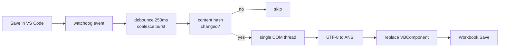
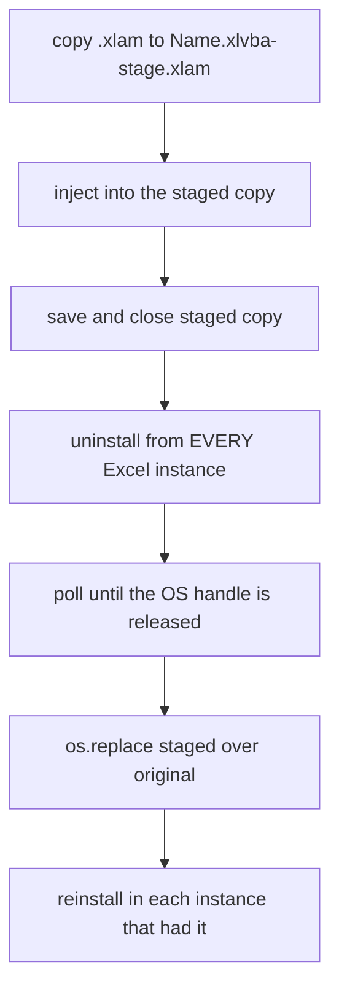

# xlvba

Edit Excel VBA in VS Code. Extract modules out of `.xlsm` workbooks and `.xlam`
add-ins, push them back, and hot-reload on save so the running code updates as
you type - including add-ins, which Excel normally keeps locked.

```
 VS Code                          xlvba                        Excel
 ───────                          ─────                        ─────
 src/MyTools/modUtil.bas  ──save──▶ watcher ──COM──▶ VBProject.VBComponents
                          ◀─extract─                 (live, no restart)
```

- **Windows only.** It drives Excel through COM (`win32com.client`); there is
  no macOS or Linux equivalent.
- **Every file on disk is UTF-8.** The VBE reads and writes the legacy ANSI
  code page, so xlvba transcodes in both directions and tells you when a
  character cannot survive the trip.
- **Add-ins are first class.** Two reload strategies, both tested against a
  genuinely installed and file-locked `.xlam`.

---

## Contents

- [Requirements](#requirements)
- [Install](#install)
- [Enable "Trust access to the VBA project object model"](#enable-trust-access-to-the-vba-project-object-model)
- [Quick start](#quick-start)
- [How hot-reload works](#how-hot-reload-works)
- [Live mode vs swap mode](#live-mode-vs-swap-mode)
- [Commands](#commands)
- [Configuration (`xlvba.json`)](#configuration-xlvbajson)
- [File layout and extensions](#file-layout-and-extensions)
- [VS Code integration](#vs-code-integration)
- [Troubleshooting](#troubleshooting)
- [Known limitations](#known-limitations)
- [Development](#development)

---

## Requirements

| Requirement | Notes |
|---|---|
| Windows | COM automation; tested on Windows 10/11 |
| Microsoft Excel | Desktop Excel. Tested on Microsoft 365 (16.0) |
| Python 3.9+ | Tested on 3.11 |
| `pywin32` | COM bridge; needs a post-install step |
| `watchdog` | Only for `xlvba watch` |

---

## Install

```powershell
git clone https://github.com/LewisCrouch/XLScripts.git
cd XLScripts

python -m venv .venv
.\.venv\Scripts\python.exe -m pip install -r requirements.txt

# Registers the COM type libraries pywin32 needs.
.\.venv\Scripts\python.exe .\.venv\Scripts\pywin32_postinstall.py -install

# Install the CLI itself (editable, so you can hack on it).
.\.venv\Scripts\python.exe -m pip install -e .
```

Then confirm the whole chain works:

```powershell
.\.venv\Scripts\python.exe -m xlvba doctor
```

Everything in this README uses `python -m xlvba`. After `pip install -e .` a
plain `xlvba` command is also on PATH inside the virtualenv.

---

## Enable "Trust access to the VBA project object model"

**Nothing works without this.** Excel blocks all programmatic access to VBA
projects by default.

1. Excel > **File** > **Options**
2. **Trust Center** > **Trust Center Settings...**
3. **Macro Settings**
4. Tick **Trust access to the VBA project object model**
5. **Restart Excel completely** (check Task Manager for stray `EXCEL.EXE`)

`xlvba doctor` reads the underlying registry value and also performs a live
probe against an open workbook:

```
[ ok ] Trust access to VBA project: Office 16.0: AccessVBOM=1
[ ok ] VBProject access (live): verified against Book1
```

The registry value lives at
`HKCU\Software\Microsoft\Office\<version>\Excel\Security\AccessVBOM`.
Setting it by hand works, but Excel must be restarted afterwards.

> This setting lets any code running on your machine rewrite your macros.
> It is a real (if commonly accepted) reduction in your security posture.

---

## Quick start

```powershell
# 1. Point xlvba at a workbook or add-in.
python -m xlvba init --target "C:\work\Reporting.xlsm"

# 2. Pull the existing VBA into src/.
python -m xlvba extract

# 3. Start hot-reloading.
python -m xlvba watch
```

Now open `src/Reporting/modUtil.bas` in VS Code and save. The change is live in
Excel before you have switched windows.

Create a **new** file - say `src/Reporting/modNew.bas` - and the module is
created in the VBA project automatically. You do not have to touch the VBE.

---

## How hot-reload works



Three details make this reliable rather than flaky:

**Debouncing.** One Ctrl+S produces several filesystem events (truncate, write,
often an atomic rename). They are coalesced over a 250 ms window so the module
is replaced once, not four times.

**A single COM thread.** Excel is a single-threaded apartment server. All COM
work happens on one dedicated worker thread that owns its own COM apartment;
calling Excel from several watchdog threads reliably produces
*"Call was rejected by callee"*.

**Content hashing.** `.xlvba-state.json` records a hash of what was last
pushed. An editor that rewrites a file without changing it costs one hash and
nothing else, so autosave does not thrash your VBA project.

Prompts are suppressed for the duration of each operation (`DisplayAlerts`,
`ScreenUpdating`, `EnableEvents`, `AskToUpdateLinks`) and **always restored in a
`finally` block**, so a failure cannot leave Excel with events switched off.

---

## Live mode vs swap mode

Both are implemented and tested. `live` is the default.

### `--mode live` (default)

Injects into the VBProject already loaded in memory, then saves the workbook so
the file on disk matches.

- Fast: measured **~0.1 s** for an add-in edit
- Preserves module-level state and open userforms
- Does not re-run `Workbook_Open` / `Workbook_AddinInstall`
- Works on a locked, installed `.xlam` - no unload needed

### `--mode swap`

The full add-in lifecycle, for when you want a genuinely clean reload:



- Measured **~0.9 s**
- Re-runs `Workbook_Open` and `Workbook_AddinInstall`; module-level state is lost
- Guarantees the on-disk file is authoritative

Two subtleties this handles that naive implementations miss:

1. **Staging first.** Code is injected into a *copy*, not the live add-in. If
   you edited the live add-in and then swapped the file, the save would
   overwrite the very change you just made.
2. **Every Excel instance.** Excel can run several processes at once, and an
   add-in loaded in instance B keeps the file locked no matter what you do to
   instance A. xlvba enumerates the Running Object Table, unloads everywhere,
   waits for the handle to actually drop, then restores each instance that had
   it installed.

Set the default per target in `xlvba.json`, or override with `--mode`:

```powershell
python -m xlvba reload --target MyTools --mode swap
python -m xlvba watch --mode swap
```

---

## Commands

Global options available on every subcommand:

| Option | Meaning |
|---|---|
| `--root DIR` | Project root (default: current directory) |
| `--config FILE` | Path to `xlvba.json` (default: search upwards) |
| `--target NAME\|FILE` | One configured target, or a path to use ad hoc |
| `--src-dir DIR` | Override the source root |
| `--launch` | Start Excel if it is not already running |
| `-v, --verbose` | Per-file detail |
| `-q, --quiet` | Warnings and errors only |

### `init`

```powershell
python -m xlvba init --target Reporting.xlsm --target MyTools.xlam
```

Creates `xlvba.json`. Repeat `--target` for several files. Running it again
appends new targets rather than overwriting; use `--force` to start over.

If two targets share a filename stem (`Book.xlsm` and `Book.xlam` are a common
pair) the source folders are auto-named `Book-xlsm` and `Book-xlam`.

### `extract`

```powershell
python -m xlvba extract
python -m xlvba extract --target MyTools --prune
python -m xlvba extract --dry-run -v
```

| Option | Meaning |
|---|---|
| `--prune` | Delete local files whose component no longer exists in Excel |
| `--skip-empty` | Do not write files for components with no code |
| `--dry-run` | Report without writing anything |

### `inject`

```powershell
python -m xlvba inject
python -m xlvba inject --file src/MyTools/modUtil.bas
python -m xlvba inject --force --no-save
```

| Option | Meaning |
|---|---|
| `--file PATH` | Inject only this file (repeatable) |
| `--force` | Inject even when the content hash is unchanged |
| `--no-save` | Leave the workbook dirty instead of saving |
| `--sync-deletions` | Remove components with no local source file |
| `--dry-run` | Report without changing Excel |

New files are created automatically; there is no separate "add module" step.

### `reload`

```powershell
python -m xlvba reload --target MyTools --mode swap
```

Inject plus, in swap mode, the full add-in unload/replace/reload cycle.

### `watch`

```powershell
python -m xlvba watch
python -m xlvba watch --target MyTools --mode swap --debounce 400
python -m xlvba watch --initial-sync
```

| Option | Meaning |
|---|---|
| `--mode live\|swap` | Override the configured reload mode |
| `--debounce MS` | Coalesce window (default 250) |
| `--sync-deletions` | Mirror local deletions into the VBA project |
| `--initial-sync` | Push everything once at startup, then watch |

Stop with Ctrl+C.

### `list`

```powershell
python -m xlvba list
```

Shows both sides at once, including files that exist only locally:

```
Demo-xlsm (Demo.xlsm)
file              type             lines  local  notes
----------------  ---------------  -----  -----  ---------------
modDemo.bas       standard module  11     yes
CDemo.cls         class module     12     yes
frmDemo.frm       userform         6      yes
Sheet1.dcm        document module  5      yes    Sheet: Data
ThisWorkbook.dcm  document module  5      yes    ThisWorkbook
modBrandNew.bas   local only       -      yes    will be created
```

### `doctor`

```powershell
python -m xlvba doctor
```

Checks platform, `pywin32`, `watchdog`, encoding, the `AccessVBOM` registry
value, a live VBProject probe, and every configured target. Each failure comes
with the specific fix. Exit code is non-zero if a critical check fails, so it
works in CI or a pre-commit hook.

---

## Configuration (`xlvba.json`)

Created by `init`, searched for upwards from the current directory. See
[`xlvba.example.json`](xlvba.example.json).

```json
{
  "src_dir": "src",
  "ansi_encoding": "cp1252",
  "debounce_ms": 250,
  "launch_excel": false,
  "sync_deletions": false,
  "ignore": ["**/*.frx", "**/~$*"],
  "targets": [
    {
      "path": "workbooks/Reporting.xlsm",
      "name": "Reporting",
      "mode": "live",
      "save_after_inject": true,
      "exclude": ["Sheet1"]
    }
  ]
}
```

| Key | Default | Meaning |
|---|---|---|
| `src_dir` | `"src"` | Root for extracted code; each target gets a subfolder |
| `ansi_encoding` | `"cp1252"` | The VBE's code page. Change on non-Western installs |
| `debounce_ms` | `250` | Watcher coalesce window |
| `launch_excel` | `false` | Start Excel automatically when it is not running |
| `sync_deletions` | `false` | Deleting a local file removes the component |
| `ignore` | see example | Glob patterns excluded from watching and injection |

Per target:

| Key | Default | Meaning |
|---|---|---|
| `path` | required | `.xlsm`/`.xlam`, absolute or relative to the project root |
| `name` | filename stem | Source subfolder name |
| `mode` | `"live"` | `live` or `swap` |
| `save_after_inject` | `true` | Save so the disk file matches the loaded project |
| `exclude` | `[]` | Component names never extracted or injected |

`sync_deletions` is off by default deliberately: an accidental file deletion
should not silently destroy working code in your workbook.

### Ad-hoc use without a config

```powershell
python -m xlvba extract --target "C:\work\Reporting.xlsm" --src-dir vba
```

Passing a file path to `--target` skips `xlvba.json` entirely.

---

## File layout and extensions

```
your-project/
├─ xlvba.json
├─ .xlvba-state.json        generated; safe to delete
└─ src/
   ├─ Reporting/
   │  ├─ modUtil.bas        standard module
   │  ├─ CThing.cls         class module
   │  ├─ frmMain.frm        userform code + layout
   │  ├─ frmMain.frx        userform binary resources
   │  ├─ Sheet1.dcm         sheet code module
   │  └─ ThisWorkbook.dcm   workbook code module
   └─ MyTools/
      └─ modAddin.bas
```

| Extension | VBComponent type | Sync method |
|---|---|---|
| `.bas` | 1, standard module | remove + import |
| `.cls` | 2, class module | remove + import |
| `.frm` (+ `.frx`) | 3, userform | remove + import |
| `.dcm` | 100, document module | in-place line replace |

**Why `.dcm`?** Sheet and `ThisWorkbook` modules cannot be removed or imported -
they belong to the document. They are updated in place via `DeleteLines` +
`AddFromString`. The distinct extension keeps them from being confused with
class modules, which *are* import-replaced. Files are matched to sheets by
**CodeName**, not by the tab caption, so renaming a worksheet tab does not
break the mapping.

**`.frx` files are binary.** They hold the form layout and embedded resources.
Commit them next to the `.frm`, but they cannot be diffed or merged by hand -
treat a userform as a single unit and avoid concurrent edits.

Standard modules are injected before classes, then userforms, then document
modules, so helper code exists before the things that reference it.

---

## VS Code integration

The repo ships `.vscode/tasks.json` and `.vscode/settings.json`.

### Run the watcher as a task

**Ctrl+Shift+P** > **Tasks: Run Task** > **Start VBA Watcher**. It runs in a
dedicated background terminal. Other tasks provided: *Extract VBA*, *Inject
VBA*, *Reload Add-in (swap)*, *Doctor*.

To launch it automatically when the folder opens, add to the task:

```json
"runOptions": { "runOn": "folderOpen", "instanceLimit": 1 }
```

### Syntax highlighting

`.vscode/settings.json` maps `.bas`, `.cls`, `.frm` and `.dcm` to the built-in
`vb` language. For real VBA support install an extension such as **VBA** by
*spences10* and remap the associations to `vba`.

### Keeping files sane

The provided settings force UTF-8, spaces, and a 4-space indent, and disable
trailing-whitespace trimming for VBA files - the VBE is sensitive to line
continuations and stripping trailing spaces can change meaning.

### Watcher vs. VS Code auto-save

If you use `files.autoSave: afterDelay`, set the delay comfortably above
`debounce_ms` (for example autosave 1000 ms, debounce 250 ms). Otherwise you
will sync half-typed lines. `onFocusChange` works well.

---

## Troubleshooting

### "Programmatic access to Visual Basic Project is not trusted"

The Trust Center setting is off, or Excel was not restarted after enabling it.
See [the setup section](#enable-trust-access-to-the-vba-project-object-model).
Run `xlvba doctor` to confirm. Note the setting is **per Office version** and
per user.

### "Call was rejected by callee" (`0x80010001`)

Excel was busy - mid-recalculation, a modal dialog was open, or a cell was
being edited. xlvba retries with exponential backoff (~4 s total) and only then
gives up. If you see it repeatedly, something is genuinely blocking Excel:
close open dialogs and press Escape to leave cell-edit mode.

### The add-in file stays locked

```
ERROR MyTools.xlam is still locked 15s after unloading it from 2 Excel instance(s).
      An Excel owner file is still present (~$MyTools.xlam).
```

Something still holds the file. In order of likelihood:

1. Another Excel process. Check Task Manager for multiple `EXCEL.EXE`.
2. A macro from the add-in is still running, or the VBE is in break mode -
   press **Reset** (the stop button) in the VBE.
3. A stale `~$MyTools.xlam` owner file after an Excel crash. Close Excel and
   delete it.
4. Antivirus or a sync client (OneDrive, Dropbox) scanning the file. Add an
   exclusion, or keep add-ins outside synced folders.

Use `--mode live` to sidestep the whole problem - it never needs the file
unlocked.

### Changes do not appear in Excel

- Confirm the target is actually open: `xlvba list` shows `not open` per target
  in `doctor` output.
- With several Excel instances running, make sure the workbook is open in one
  of them. xlvba prefers the instance that already hosts the file, but it
  cannot inject into a file nobody has open unless it opens it itself.
- Check the file is under the configured `src_dir` and matches a target folder.
- Delete `.xlvba-state.json` and retry with `--force` if you suspect a stale
  hash.

### Non-ASCII characters became `?`

```
WARN modUtil: 2 character(s) are not representable in cp1252 and were
     replaced with '?' (line 14: U+1F600, line 22: U+4E2D)
```

The VBE stores code in the ANSI code page, which cannot hold emoji or CJK. This
is a hard VBA limitation, not an xlvba one. Keep such text in worksheet cells
or an external resource file rather than string literals. Accented Latin
characters (`é`, `ü`, `€`) round-trip fine.

### `ModuleNotFoundError: No module named 'win32com'`

Dependencies were installed into a different interpreter. Use the venv's
Python explicitly (`.\.venv\Scripts\python.exe -m xlvba ...`) and run the
`pywin32_postinstall.py -install` step.

### A userform lost its controls

The `.frx` was missing when the `.frm` was injected. Both files must sit side
by side. Recover with `xlvba extract --force` from a good copy of the workbook.

### The watcher is not reacting

- It only watches under `src_dir`; files elsewhere are ignored.
- Check your `ignore` patterns.
- Editing on a network share can suppress filesystem events - work locally.

---

## Known limitations

- **Windows and desktop Excel only.**
- **Password-protected VBA projects cannot be touched.** Unlock via
  *Tools > VBAProject Properties > Protection* first; xlvba detects this and
  says so rather than failing obscurely.
- **Document modules cannot be created or deleted**, only edited. A `.dcm`
  file with no matching sheet is reported as skipped.
- **Emoji and CJK cannot be stored in VBA source** (see above).
- **`.frx` files are binary** and unmergeable.
- **Injecting while code is running or the VBE is in break mode will fail.**
  Stop execution first.
- **No conflict detection.** If you edit in the VBE *and* in VS Code, the next
  sync overwrites the VBE side. Run `xlvba extract` first to pull VBE changes
  down.

---

## Development

```powershell
.\.venv\Scripts\python.exe -m pip install -e .
```

Source layout:

| Module | Responsibility |
|---|---|
| `xlvba/cli.py` | Argument parsing |
| `xlvba/commands.py` | One handler per subcommand |
| `xlvba/watch.py` | Debounced watcher + single-flight COM worker |
| `xlvba/core/excel.py` | COM attach, ROT enumeration, prompt suppression |
| `xlvba/core/addin.py` | `.xlam` lifecycle, lock probing, atomic replace |
| `xlvba/core/vbproject.py` | Enumerate and export components |
| `xlvba/core/mutate.py` | Import, replace, create, remove (with rollback) |
| `xlvba/core/codec.py` | UTF-8 <-> ANSI bridge, VBE header parsing |
| `xlvba/core/config.py` | `xlvba.json` |
| `xlvba/core/state.py` | Content-hash cache |
| `xlvba/core/errors.py` | HRESULT decoding, actionable exceptions |

`xlvba.json` and `src/` are gitignored here because this repo ships the tool,
not anyone's VBA. If you want to use it to version your own macros, delete
those two lines from `.gitignore`.

## License

MIT - see [LICENSE](LICENSE).
